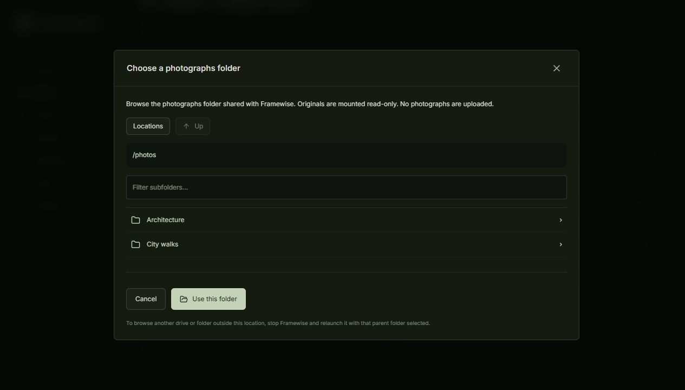

# Framewise

**Your best frames, discovered.** A local photography curation desk for Nikon NEF, JPEG and PNG.

Turn a folder of photographs into an editing shortlist, inspect portfolio candidates and compare a
Competition Top 3. Keep the final decision. Originals stay untouched; inference and preference learning
run on your own machine.

[Get started](#run-with-docker) · [Personalise your shortlist](docs/preferences.md) ·
[Highlights guide](docs/highlights.md) · [Validation](docs/highlights-validation.md) ·
[Launch article](docs/blog/framewise.md)

[Docker 0.2 validation](docs/docker-validation.md): 62 tests, a full 403-image CPU scan, read-only mounts,
host-path exports, restart persistence and a 2.7-second cached rescan on the validation workstation.

## Run with Docker

Install [Docker Desktop](https://www.docker.com/products/docker-desktop/), extract the Docker bundle and
double-click **Start Framewise.cmd**. Choose your photo parent in the Windows dialog. The launcher loads
the prebuilt image (or builds from source), waits for readiness and opens the app. No host Python, Node,
ExifTool or CUDA setup. **Stop Framewise.cmd** stops it while preserving selections.

In **Scan → Choose folder**, browse the read-only photo mount and click **Use this folder**. For AI,
use **Settings → Approve download & install AI (~350 MB)** once. Prebuilt bundles target Linux/amd64
and require Docker; they are not standalone native executables. [Docker setup and packaging guide](docs/docker.md).




*Actual application screenshots using project-owned, labelled procedural illustrations. Demo Highlights
use lowered quality floors to show the interface. No personal photographs are included. These images
are not evidence of photographic ranking accuracy.*

## A complete review workflow

| Workspace | What you can do |
| --- | --- |
| **Library** | Create, reopen, rename and permanently remove collections. Removal clears app records and previews after typed confirmation; source folders stay untouched. |
| **Scan** | Choose a folder with the folder browser, discover NEF/JPEG/PNG files recursively, watch real progress, pause and resume. |
| **Curate** | Inspect measurements and related frames, keep/exclude/rate, and choose a 5%, 10%, 25% or custom selection budget. |
| **Selected** | Review final Lightroom Picks, including your manual overrides. |
| **Highlights** | Review Flickr Standouts and a separate Competition Top 3; compare, replace/promote finalists and inspect alternatives. |
| **Export** | Download category CSVs containing source paths, ranks, overrides and provenance. Verified JPEG/NEF pairs hand off the original RAW. |
| **Settings** | Adjust weights and train, inspect, apply, pause or forget an experimental local preference profile. |


**Lightroom Picks** are the editing shortlist. **Flickr Standouts** are a thresholded subset of final
picks. **Competition Top 3** has independent quality floors, duplicate suppression and soft diversity.
It can return fewer than three unless you explicitly enable Exactly three. Manual choices survive rescans.
Scores do not predict publication, Flickr engagement or competition wins.

### Compare the evidence

The lightbox shows actual aesthetic-model output, detail/tonal proxies, clipping, provenance and available
EXIF. Side-by-side comparison adds perceptual-hash distance and matching CLIP cosine similarity. Preview
clipping does not establish unrecoverable RAW detail; visual distance does not establish originality.


### Make it fit your taste

For a shorter list, choose **Curate → Very selective · 5%** or **Selective · 10%**. For stricter exceptional
recommendations, open **Highlights → Ranking controls & quality floors → Use stricter floors**, review
the proposed values and save. Manual Keep/Exclude choices remain protected.

For personal ranking, open photographs and choose **My taste → Like / Dislike**. These labels are separate
from Keep/Exclude and stars. After at least **10 distinct likes and 10 distinct dislikes** with compatible
embeddings, train in Settings. A grouped holdout checks a small local centroid learner; profiles need 60%
held-out balanced accuracy before you can explicitly apply a 30% taste blend. Training starts paused.
New feedback requires retraining. You can pause or forget the profile.

The small internal check does not prove future quality. Actual personal agreement needs your labels and
independent evaluation trips. [Algorithm, limits and data controls](docs/preferences.md).


## Native Windows setup (alternative)

Requires Python **3.11+**, Node **22.12+**, [uv](https://docs.astral.sh/uv/) and
[ExifTool](https://exiftool.org/). CPU inference needs no CUDA or NVIDIA GPU.

```powershell
git clone https://github.com/JordiCorbilla/framewise-curator.git
cd framewise-curator
winget install --id OliverBetz.ExifTool --exact
.\scripts\setup.ps1 -WithAI
# Explicit approval for the one-time ~350 MB model download:
.\backend\.venv\Scripts\python.exe .\scripts\install_models.py --approve-download
.\scripts\start.ps1
```

Open **http://127.0.0.1:8765**. `start.ps1` opens the browser and runs the server hidden;
`start.ps1 -NoBrowser` keeps your existing tab, and `stop.ps1` stops the server. Logs live in `.local`;
app data lives in `%LOCALAPPDATA%\Framewise`, separate from source photographs.

Plain `setup.ps1` installs classical analysis and optional RAW fallback. AI dependencies and weights are
optional; `setup.ps1 -DownloadModels` installs weights after explicit consent. Setup uses the internet;
subsequent inference uses local files. Missing AI is honestly shown as technical-only. Fonts and icons
are bundled locally. Bind this single-user app to localhost; do not expose it publicly.

### Your first Nikon scan

1. Open **Scan → Choose folder**, navigate to your photographs and click **Use this folder**. Manual paths remain optional. Choose whether to include subfolders.
2. Start the scan. Previews appear in batches while indexing and scoring progress updates.
3. Review **Curate**. Open an image; **P** keeps, **X** excludes, **U** resets, **1–5** rates,
   arrow keys navigate the current page, and **Esc** closes the viewer.
4. Open **Selected** for the editing shortlist, or **Highlights** for standouts and finalists.
5. Open **Export** and download `lightroom_picks.csv`, `flickr_standouts.csv`, `competition_top3.csv`
   or `competition_alternatives.csv`. [Lightroom handoff instructions](docs/lightroom.md).

CSV does not automatically create a Lightroom Collection. XMP writing is disabled; develop settings
are never overwritten. Framewise does not upload to Flickr or submit competitions.

### Collection management

**Library → Rename** changes the display title. **Remove** asks you to type the exact title, then permanently
removes app records, selections, taste labels and cached previews. Wait for any active scan to stop first.
Original pictures and folders stay untouched. Removing a collection also resets the global taste model;
other collections’ labels remain available for retraining. Downloaded CSVs and your own backups are separate.

## Built locally, checked with real files

FastAPI, SQLAlchemy and SQLite behind React 19, TypeScript, Vite and TanStack Query. Real CPU inference
uses **OpenAI CLIP ViT-B/32 + LAION aesthetic predictor V1**, with pinned checkpoint provenance and hashes.
Two preview workers, batches of eight, SQL pagination and cache reuse keep image memory bounded.

Integration checks cover **381 Nikon D850 NEFs plus 22 edited JPEGs**, 403 ready previews/embeddings,
stable rankings, verified NEF exports and unchanged source integrity. Preference training is tested with
synthetic vectors; that does not measure personal artistic agreement. [Full evidence](docs/highlights-validation.md).

No telemetry, cloud inference or image uploads. Private photographs, databases, weights and source-integrity
manifests are excluded from the repository. [Architecture](docs/architecture.md) · [Scoring](docs/scoring.md).

## Development and validation

```powershell
cd backend
uv sync --frozen --python 3.11 --extra dev --extra ai --extra raw
.\.venv\Scripts\python.exe -m uvicorn framewise.api.app:app --host 127.0.0.1 --port 8765
# Another terminal:
cd frontend
npm ci
npm run dev
```

Vite serves `http://127.0.0.1:5173` and proxies `/api`. Set `FRAMEWISE_EXIFTOOL` for a custom ExifTool
location or `FRAMEWISE_DATA_DIR` before starting to isolate data. Run one backend process per data directory.

```powershell
cd backend
.\.venv\Scripts\pytest.exe -q
.\.venv\Scripts\ruff.exe check framewise tests ..\scripts
.\.venv\Scripts\ruff.exe format --check framewise tests ..\scripts
cd ..\frontend
npm run lint
npm run build
npm audit
```

Tests use generated fixtures; real D850 validation is recorded separately. Other NEF variants and a
1,000–5,000-file performance soak still need qualification. [Offline favourite evaluation](docs/highlights.md#offline-preference-evaluation).

`scripts/make_showcase.py` generates twelve original, labelled JPEG illustrations; `make_demo.py` makes
the original eight-image demo. Use a separate data directory for public screenshots.
[Image provenance and capture setup](docs/images/README.md). The [blog article](docs/blog/framewise.md)
is a local publication-ready draft; nothing has been published automatically.

Deferred: XMP writes, standalone native installer, advanced critiques, genre/theme judging,
sensor-level RAW inspection and large-library performance qualification. The preference learner is experimental.

UI inspiration: [Facet](https://github.com/ncoevoet/facet), [Selects](https://github.com/bihanikeshav/selects).
No code copied from either. The existing CC0 repository license is preserved. Dependencies, model checkpoints
and Inter retain their own licenses; [bundled font notice](frontend/public/licenses/Inter-OFL.txt).
