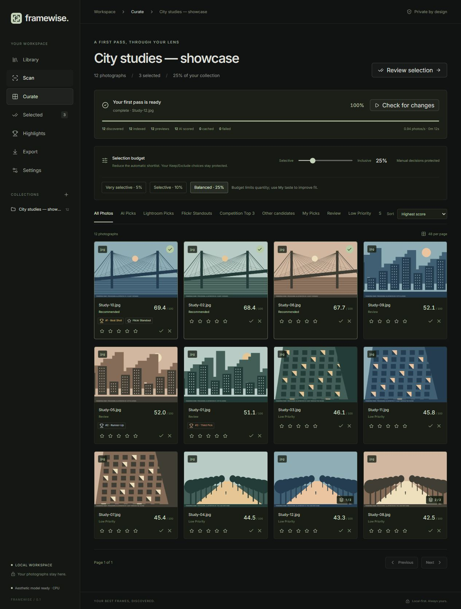
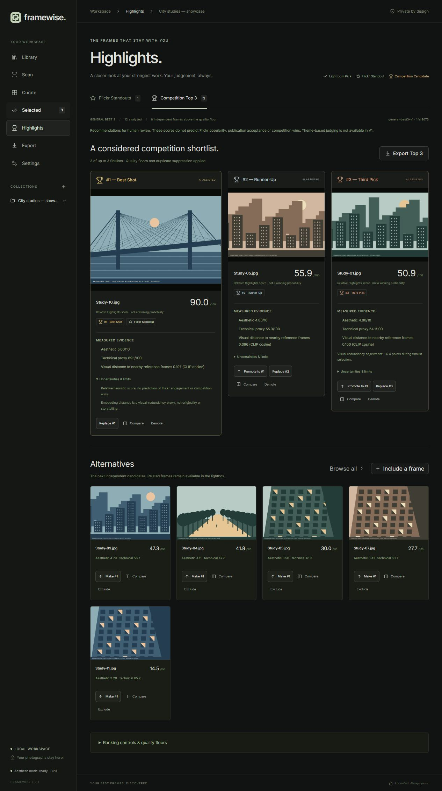
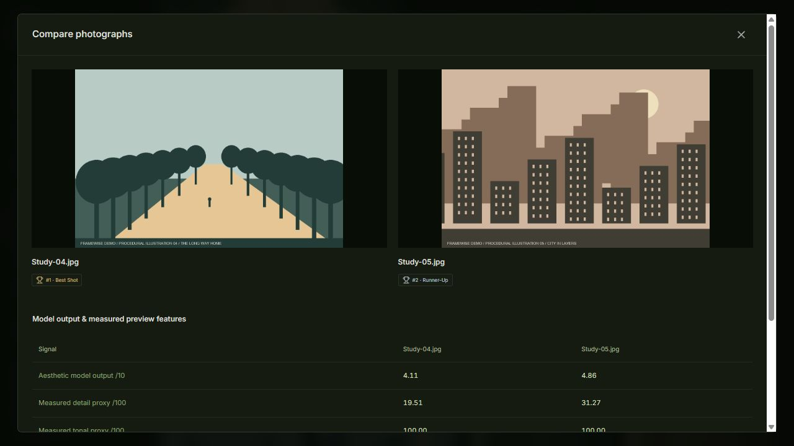
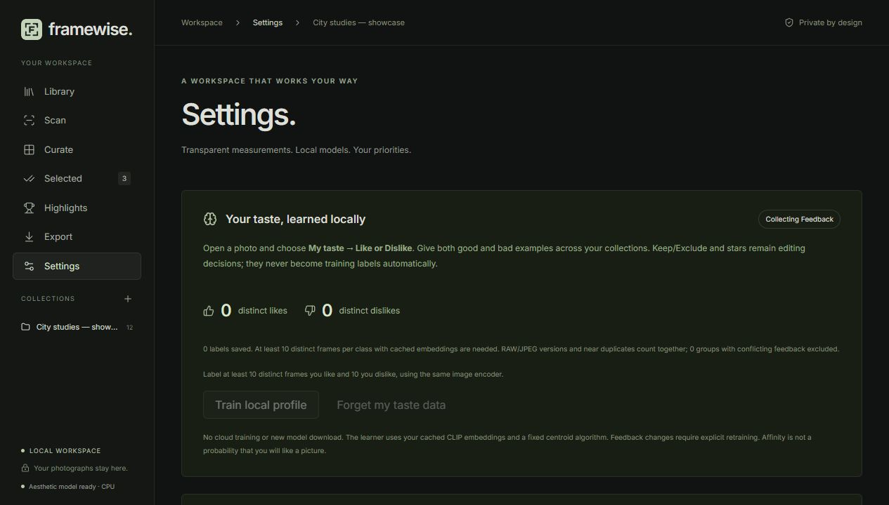

# Framewise: a local AI curation desk for the photographs worth editing

Coming back from a trip with hundreds of RAW files creates a familiar problem: deciding where to start.
There may be several versions of the same view, a frame with slightly better timing, and a technically
imperfect photograph that still deserves an edit. A folder full of files does very little to help.

I built **Framewise** to make that first review easier. It runs on my own machine, reads Nikon NEF,
JPEG and PNG files, and prepares a shortlist I can inspect before opening Lightroom.

The final choice stays with the photographer. That matters, especially when an AI score disagrees with
what I actually like.

*The screenshots use project-owned procedural illustrations, labelled as demo images. They show the
real application without publishing personal photographs. Demo Highlights use deliberately lowered
quality floors to illustrate the interface; they are not a ranking-quality benchmark.*

## One collection, three different decisions

Choosing photographs to edit is different from choosing photographs to publish. Choosing three frames
to consider for a competition is another decision again.

Framewise keeps these separate:

- **Lightroom Picks** are the editing shortlist. A percentage budget controls the automatic selection,
  and I can keep or exclude any individual frame.
- **Flickr Standouts** are a smaller set within the final editing shortlist, with their own aesthetic
  threshold, percentile and automatic count limit.
- **Competition Top 3** uses a separate relative ranker with quality floors, duplicate suppression and
  a soft visual-redundancy penalty. It can return fewer than three if the collection does not meet the floors.

There is an explicit override for exactly three when possible, and manual choices are labelled as such.
None of these categories predicts publication acceptance, Flickr engagement or a competition result.

## What the AI measures

The local aesthetic pipeline uses OpenAI CLIP ViT-B/32 and the matching LAION V1 aesthetic predictor.
It runs on the CPU. A one-time, explicitly approved download installs the weights; subsequent inference
uses local files.

Framewise also measures preview detail, tonal distribution and clipping. Perceptual hashes and capture
times help group related frames. Cached CLIP embeddings provide a visual-distance signal for Highlights.
Those signals are useful, but their names need to stay precise. Visual distance is not proof of originality.
Preview clipping does not tell me how much highlight detail can be recovered from a RAW file.

I can open two candidates side by side and compare their actual measurements. I can also replace the
top recommendation, promote another finalist or inspect alternatives. The app stores those decisions
separately so a rescan does not quietly undo them.

## Making the shortlist fit my taste

A general aesthetic model does not know my preferences. Reducing the selection budget from 25% to 5%
makes the list shorter, but does not necessarily make it more personal.

Framewise now has explicit **My taste → Like / Dislike** feedback in the lightbox. Keep/Exclude and
star ratings remain editing decisions. They are not silently turned into training labels.

The preference learner starts only after there are at least ten distinct liked frames and ten distinct
disliked frames with compatible cached embeddings. It fits a small centroid model locally and reserves
25% of each class as a grouped holdout. RAW/JPEG versions and near duplicates stay together; groups with
contradictory labels are excluded.

Settings shows the training count, held-out count and balanced accuracy. A profile must reach 60%
on that internal check before I can choose to apply it. When enabled, it contributes 30% of the ranking
score; the generic score contributes the other 70%. Manual choices and Highlights quality floors remain.

This is an experimental preference signal. With the minimum dataset, the holdout contains only six
groups, so the number needs context. The useful next test is agreement on a separate historical trip
that was never used for training. I have not claimed that test is passed without the human labels.

## Originals stay where they are

Framewise stores its SQLite database, model manifest and previews in application data. It reads source
photographs without moving, modifying or deleting them. Removing a collection removes its app records
and preview cache after a typed confirmation; the source folder stays untouched.

CSV exports include original paths, categories, ranks, manual overrides and model/configuration
provenance. Where an edited JPEG can be associated unambiguously with a registered NEF using filename
stem, capture time and camera metadata, the handoff points to that NEF and records which image was analysed.
For an unpaired raster, it preserves the real raster path.

The current handoff is deliberately manual. CSV does not create a Lightroom Collection automatically,
and XMP writing is disabled. Framewise does not upload photographs to Flickr or submit competitions.

## What has been verified

The real integration collection contains 403 images: 381 Nikon D850 NEFs and 22 edited JPEGs. All 403
have previews and cached embeddings, with zero processing failures in the recorded run. Repeated
Highlights recalculation produced identical rankings, and the category exports resolved to existing NEFs.
The original 381 NEFs retained their recorded hashes, sizes and modification times.

The aesthetic pipeline also matched its reference implementation exactly in an offline inference check.
The test suite covers deterministic ranking, duplicate suppression, manual replacement, persistence,
exports, collection removal and the preference-training workflow. These are functional checks; they do
not establish that the model chooses the photographs a person would choose.

The implementation uses FastAPI, SQLAlchemy and SQLite behind a React/TypeScript interface. Inter is
self-hosted, and the browser connects to localhost. No telemetry or cloud inference is part of the workflow.

## Try it

The Docker edition is designed to make setup simpler: extract the starter bundle, launch Framewise,
choose a photo parent and browse trips with the in-app folder chooser. Python, Node, ExifTool and CPU
libraries are inside the container. Docker Desktop is still required; model weights install only after
explicit approval in Settings. Read-only mounts protect originals, while a persistent volume keeps decisions.

The code and Windows setup instructions are in the [Framewise repository](https://github.com/JordiCorbilla/framewise-curator).
Start with a small collection, inspect the recommendations, and use the budget controls to decide how
much work you want to carry into the edit. Then give it examples of what you like and dislike.

The direction I want for Framewise is practical: less time sorting files, clearer reasons for the shortlist,
and more time editing the frames that matter to me.
